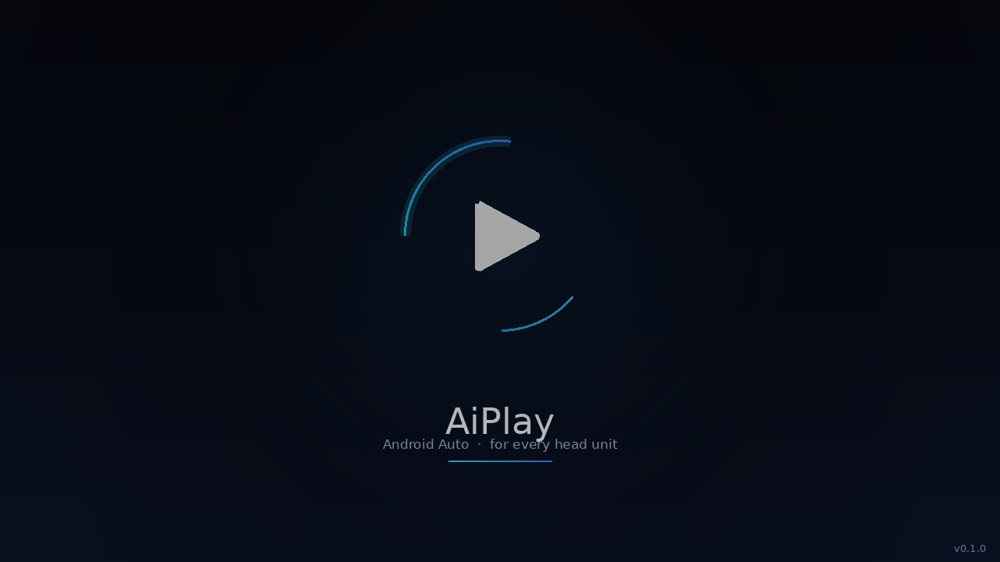
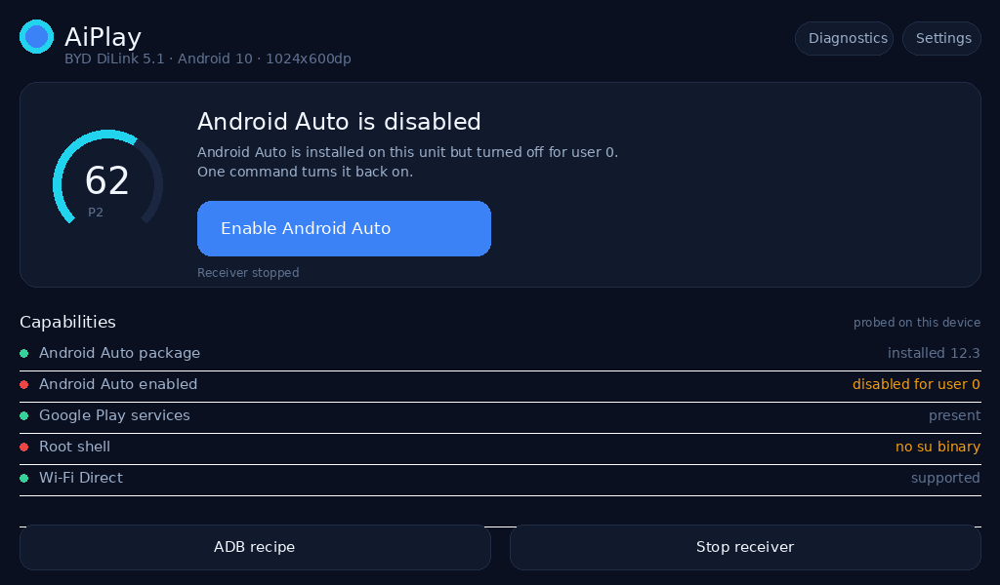

# AiPlay

**Android Auto on head units that were never sold with it.**

AiPlay is a small, offline Android app for aftermarket Android head units. It tells you *why*
your unit has no Android Auto — and fixes the fixable cases in one tap — then offers a native
Android Auto wireless endpoint for the units where nothing can be enabled.

* **217 KB APK**, no native libraries, no webview, no telemetry, no account.
* Works from **Android 7.0 (API 24)** to **Android 14 (API 34)**.
* Splash screen, home screen and diagnostics designed for a 1024×600 dashboard, not a phone.
* Evidence first: every green tick on the home screen was probed on *your* device, just now.

> AiPlay is unofficial. "Android Auto" is a Google product; AiPlay is not affiliated with,
> endorsed by or certified by Google. It ships no Google code and no Apple identity.

---

## What it actually does

| Your head unit | AiPlay's answer |
| --- | --- |
| Android Auto installed and enabled | **Open Android Auto** |
| Android Auto installed but disabled | **Enable Android Auto** — one privileged `pm enable` |
| Android Auto enabled but hidden by the ROM | **Repair Android Auto** — re-install for user 0, grant, relaunch |
| No Android Auto package, Play services present | **Wireless receiver** (experimental) |
| No Android Auto and no Play services | **Wireless receiver** (experimental) — the only route left |
| No root and no ADB | A copy-paste **ADB recipe** that does exactly the same thing from a laptop |

The condition model (P1–P5) is documented in [PLAN.md §2](PLAN.md) and
[docs/COMPATIBILITY.md](docs/COMPATIBILITY.md).

## Status — read this before installing

| Layer | State |
| --- | --- |
| Capability audit | **working**, unit-tested |
| Enable / repair Android Auto | **working** where a root shell exists, ADB recipe otherwise |
| Wireless receiver: plain TCP + in-band TLS, AA control plane, **video channel** | **implemented and tested** (JVM, OpenSSL peer, emulator), **not yet verified against a live phone** |
| Receiver: video channel + H.264 decode to screen | **implemented** (0.2.0-alpha1); on-device rendering is checked by `tools/device-test.sh`, not yet run |
| Receiver: audio (media, speech, system), touch and keys, sensors | **implemented** (0.2.0-alpha6), emulator-verified end to end; no microphone, so no voice assistant |
| Start on ignition (ACC) | **implemented** (0.2.0-alpha7): boot, fast-boot resume, wake, car mode, a unit's own action. Android has no standard ignition signal, so it depends on what your unit sends; Android 12+ also needs a battery exemption. Verified on an emulator only (docs/IGNITION.md) |
| Bluetooth bootstrap (phone learns the address and Wi-Fi) | **implemented, message exchange tested**; the Bluetooth/RFCOMM side has **never run on hardware** (docs/PROTOCOL.md 8) |
| Real phone over Wi-Fi | **untried**. Open questions: does the phone connect to AiPlay's Bluetooth service at all (the reference dongle also advertises over BLE and nudges with a headset profile; AiPlay does not), and does it accept AiPlay's self-signed identity (docs/PROTOCOL.md 2.4, 8.2) |

The receiver is honest about this: it is experimental. It completes version negotiation and service
discovery, shows the video, plays media/navigation/system audio, sends touches and keys back and reports
day/night and driving status. All of that is verified against an emulator and a stand-in phone, none of it
against a real phone, and there is no microphone channel.

## Install

```sh
# build it yourself (no Gradle)
ANDROID_HOME=/path/to/android-sdk ./tools/build.sh
adb install -r build/AiPlay-0.1.1.apk
```

Requirements for the build: JDK 17, Android SDK build-tools 34 and platform 34. Nothing else.
See [docs/BUILD.md](docs/BUILD.md).

## Screens

| Splash | Home |
| --- | --- |
|  |  |

Both images are **design reference renders** produced by `tools/gen-preview.py` from the same
geometry, palette and easing constants as `SplashView.java` and `HomeActivity.java`. They are
not device screenshots — see [docs/TESTING.md](docs/TESTING.md) for what was and was not run
on hardware.

## Test it on a phone

Yes — AiPlay installs and runs on any Android 7+ phone. What a phone can and cannot tell you:

| On a phone | Works? | Notes |
| --- | --- | --- |
| Splash + home rendering | **yes** | best way to see the real animation |
| Capability audit | **yes** | most phones report P1 (Android Auto present and enabled) |
| Diagnostics / settings | **yes** | report saves to `Android/data/com.ejjat.aiplay/files/reports/` |
| `Enable Android Auto` | pointless | the phone already has it enabled |
| Receiver handshake | **yes, from a laptop** | phone acts as the head unit; see below |
| Projection into the phone | no | a phone cannot project into itself, and 0.1.0 has no video channel |

### Prove the receiver works, phone + laptop

```sh
# 1. install on the phone
adb install -r AiPlay-0.1.1.apk

# 2. same Wi-Fi for both, then in the app tap "Start wireless receiver"
# 3. from the laptop:
python3 tools/aa-probe.py <phone-ip>
```

Expected output:

```
connected  : plain tcp (TLS runs inside the protocol)
<- control    VERSION_REQUEST            raw version 1.1
-> control    VERSION_RESPONSE           6 byte(s)
<- control    SSL_HANDSHAKE              265 byte(s) of TLS handshake
-> control    SSL_HANDSHAKE              1266 byte(s)
<- control    SSL_HANDSHAKE              93 byte(s) of TLS handshake
-> control    SSL_HANDSHAKE              242 byte(s)
<- control    AUTH_COMPLETE              status=0
     tls up: TLSv1.2 / ECDHE-RSA-AES256-GCM-SHA384
-> control    SERVICE_DISCOVERY_REQUEST  28 byte(s)  [encrypted]
<- control    SERVICE_DISCOVERY_RESPONSE 1 channel(s), head unit='AiPlay' ...  [encrypted]
     channel 3   av          stream_type=3
...
     channel 3 opened
     sent 90 picture(s), 90 acked, 3.0s (30.0 fps)
RESULT: handshake complete over in-band TLS, video channel streamed — receiver speaks Android Auto
```

The same probe runs against a desktop harness (`tools/AaHarness.java`) that uses the identical
`AaSession` code. The probe is the *phone*: it is the TLS server (OpenSSL), the receiver the TLS
client, and it fails with `WIRE MISMATCH` if the receiver deviates from aasdk's flags or encryption.

## Why not just port DiPlay?

Because DiPlay is a **CarPlay** receiver. It speaks AirPlay, RTSP, RTP, IAP2 and MFi — an
entirely different protocol family from Android Auto's TLS + protobuf channels. AiPlay keeps
DiPlay's *product architecture* (endpoint lifecycle, display handoff, audio sink, diagnostics)
and replaces every byte on the wire.

The evidence for that statement is in [docs/REA-ANALYSIS.md](docs/REA-ANALYSIS.md), produced by
running [REA](https://github.com/morluto/rea) against the shipped DiPlay 0.2.21 APK.

## Repository map

```
PLAN.md               engineering plan: problem, architecture, UI spec, protocol, milestones
docs/REA-ANALYSIS.md  what DiPlay 0.2.21 is, from the shipped artifact
docs/ARCHITECTURE.md  module map and runtime flows
docs/PROTOCOL.md      Android Auto wire format: verified vs unverified
docs/COMPATIBILITY.md P1–P5, per-ROM notes, ADB cookbook
docs/TESTING.md       what is tested, how, and what could not be tested here
docs/ROADMAP.md       0.2.0 → 1.0.0
app/                  manifest, resources, Java sources (no AndroidX)
tests/                JUnit 4 suite for the pure core (runs on a desktop JVM)
tools/                build.sh, test.sh, gen-icons.py, aa-probe.py, AaHarness.java
```

## Licence

GPL-3.0. AiPlay reuses the architecture and product ideas of
[DiPlay](https://github.com/shihabal3amri/DiPlay) (GPL-3.0, itself based on
[xcertplay](https://github.com/shilapi/xcertplay)) and the Android Auto protocol identifiers
published in [aasdk](https://github.com/f1xpl/aasdk) (GPL-3.0). Notices are preserved; see
[LICENSE](LICENSE) and [docs/THIRD-PARTY.md](docs/THIRD-PARTY.md).
